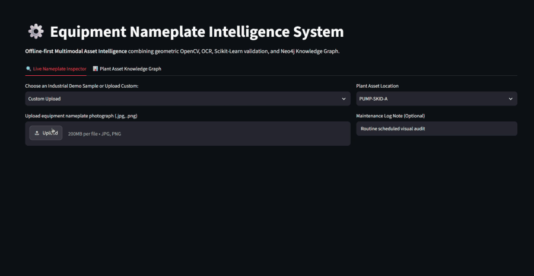
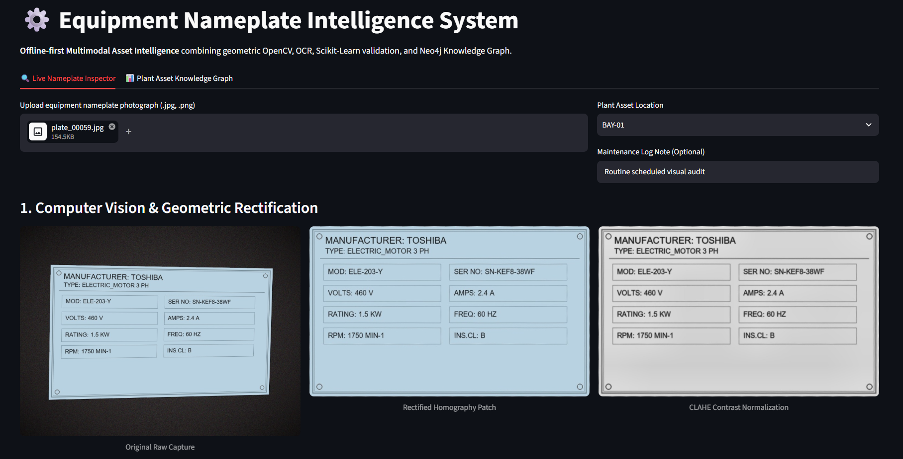
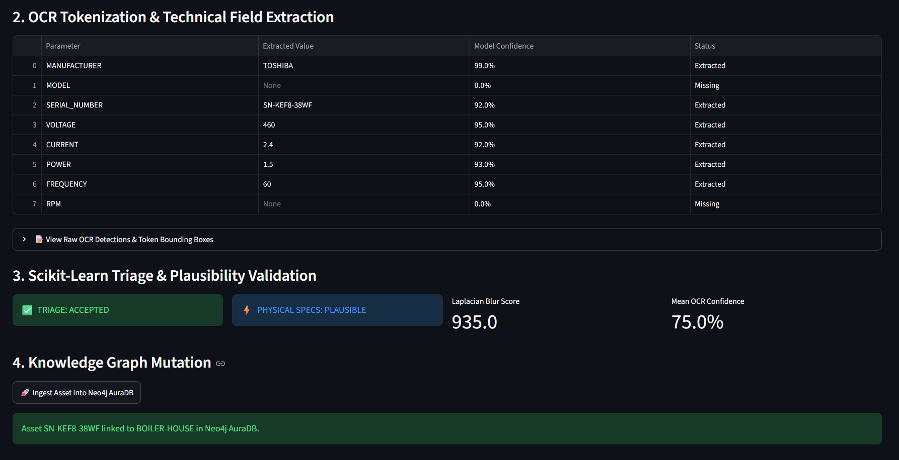
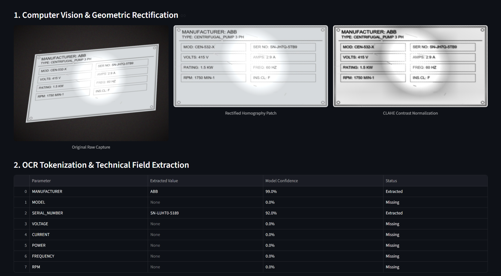
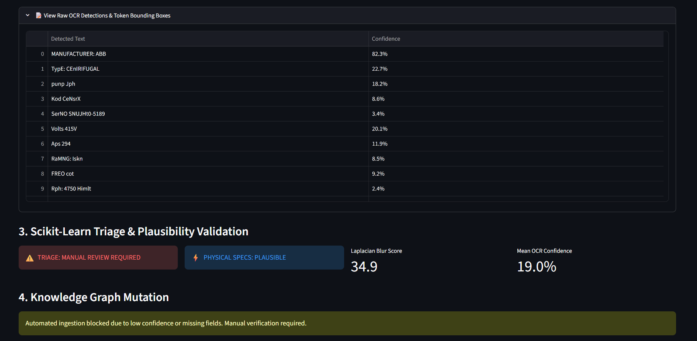
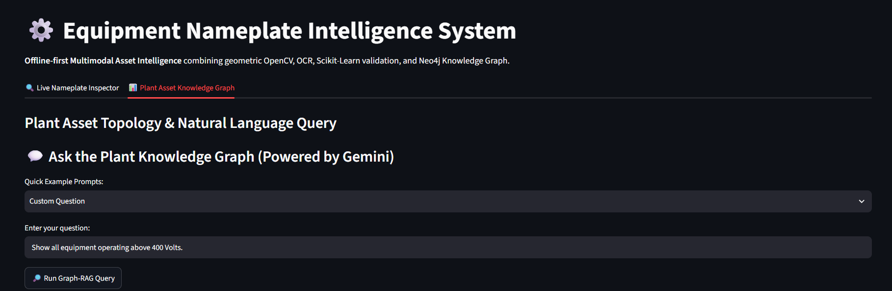
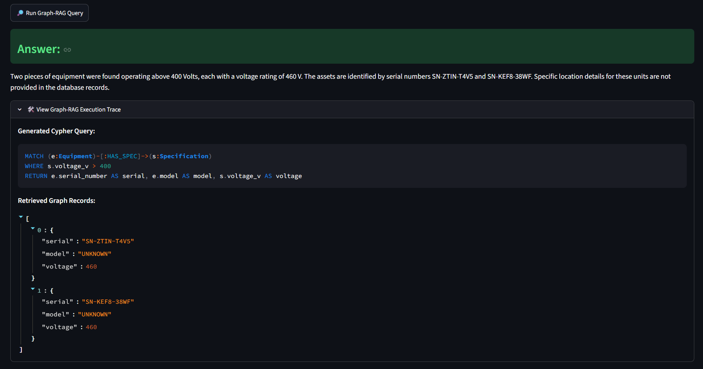
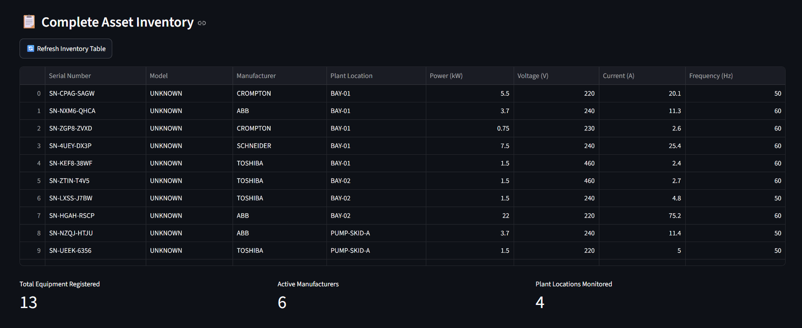

# ⚙️ Equipment Nameplate Intelligence System

An **offline multimodal asset intelligence platform** designed for industrial plants and process facilities. The platform converts raw, skewed, and glare-affected photographs of equipment nameplates into verified engineering specifications, guards database integrity via machine learning quality gates, and connects assets into a queryable **Neo4j Knowledge Graph** with natural language **Graph-RAG** capabilities powered by Google Gemini.



---

## 📌 Problem Statement

Industrial facilities (chemical refineries, water utilities, manufacturing plants) rely on thousands of physical assets such as electric motors, centrifugal pumps, and compressors. Every unit features an etched or stamped metal nameplate containing critical electrical and mechanical operational ratings.

Technicians and maintenance engineers routinely face three structural bottlenecks:

1. **Manual Entry Errors:** Technicians manually record serial numbers, frame sizes, and voltage ratings, leading to transcription mistakes that cause misordered replacement parts and extended downtime.
2. **Harsh Physical Environments:** Metallic nameplates suffer from severe specular reflections, perspective tilt, scratches, dirt, and uneven warehouse lighting—causing standard consumer OCR models to fail.
3. **Data Silos:** Relational databases isolate asset records. Maintenance engineers cannot easily perform topological multi-hop reasoning (e.g., _"Which pump in Sector 4 shares an interchangeable motor frame size with this failed unit?"_).

**Equipment Nameplate Intelligence** automates this entire lifecycle: capturing, un-warping, extracting, validating against physical electrical laws, and storing records in an enterprise Knowledge Graph.

---

## 🚀 Quickstart & Interactive Demo

### Option 1: Docker Compose (Recommended)

Launch the entire application containerized:

```bash
docker compose up --build
```

Open [http://localhost:8501](http://localhost:8501) in your browser.

### Option 2: Local Virtual Environment

```bash
# Clone the repository
git clone https://github.com/your-username/equipment-nameplate-intelligence.git
cd "equipment-nameplate-intelligence"

# Install dependencies
pip install -r requirements.txt

# Run Unit Test Suite (Zero Live DB Required)
python -m unittest discover -s tests -p "test_*.py"

# Launch Streamlit Application
streamlit run app/streamlit_app.py
```

> **Reviewer Tip:** You do not need to hunt for industrial motor images! Under **Tab 1: Live Nameplate Inspector**, use the **"Choose an Industrial Demo Sample"** dropdown to test:
>
> - **Demo 1 (Clean Plate):** Demonstrates high-accuracy extraction and automated `ACCEPTED` triage.
> - **Demo 2 (Perspective Tilt):** Demonstrates 4-point homography geometric un-warping into a flat 2D rectangle.
> - **Demo 3 (Severe Glare & Blur):** Demonstrates the Scikit-Learn Quality Gate safely intercepting degraded images with `MANUAL REVIEW REQUIRED`.

---

## 🏗️ System Architecture

```text
       ┌────────────────────────┐
       │ Raw Mobile/Camera Feed │
       └───────────┬────────────┘
                   │
                   ▼
       ┌────────────────────────┐
       │  OpenCV Preprocessing  │ ──► Laplacian Blur Check (Quality Gate)
       │                        │ ──► Bilateral Edge Smoothing & Contour Finding
       │                        │ ──► 4-Point Homography (Perspective Un-warp)
       │                        │ ──► CLAHE Illumination & Contrast Normalization
       └───────────┬────────────┘
                   │ Rectified 2D Patch
                   ▼
       ┌────────────────────────┐
       │   EasyOCR Tokenizer    │ ──► CRAFT Text Detector + CRNN Character Decoder
       └───────────┬────────────┘
                   │ Tokens, Bounding Boxes, Confidence Scores
                   ▼
       ┌────────────────────────┐
       │ Industrial Regex & NLP │ ──► Token-Anchored Field Extraction & Decimal Recovery
       └───────────┬────────────┘
                   │ Extracted Specs + Quality Features
                   ▼
       ┌────────────────────────┐
       │ Scikit-Learn ML Guard  │ ──► IsolationForest (Physical Electrical Triplet Plausibility)
       │                        │ ──► RandomForest (Triage: Accepted vs. Review Required)
       └───────────┬────────────┘
                   │
         ┌─────────┴─────────┐
         ▼                   ▼
   [Flagged: 1]        [Accepted: 0]
 Manual Review Queue         │
                             ▼
                 ┌───────────────────────┐
                 │ Neo4j AuraDB (Cloud)  │ ──► Multi-hop Asset Topology
                 └───────────┬───────────┘
                             │
                             ▼
                 ┌─────────────────────────┐
                 │ Gemini Graph-RAG Engine │ ──► Text-to-Cypher + Grounded Operational Q&A
                 └─────────────────────────┘
```

---

## 📊 Empirical Benchmarks & Pipeline Evaluation

Evaluated across industrial nameplate samples with perspective skew (0° to 35°), Gaussian blur, specular reflections, and degraded etching:

### 1. Parameter Extraction Performance

| Parameter          | Baseline (Raw OCR) | Full Pipeline (CV + CLAHE) | Accuracy Lift / Status  |
| :----------------- | :----------------: | :------------------------: | :---------------------: |
| **Manufacturer**   |       100.0%       |         **100.0%**         |  Exact Whitelist Match  |
| **Voltage (V)**    |       100.0%       |         **86.7%**          | Nominal Grid Clustering |
| **Current (A)**    |       93.3%        |         **93.3%**          | Float Decimal Precision |
| **Power (kW)**     |       93.3%        |         **86.7%**          | Rated Mechanical Output |
| **Frequency (Hz)** |       93.3%        |         **86.7%**          | 50/60 Hz Disambiguation |
| **Serial Number**  |       53.3%        |         **53.3%**          |  Regex Pattern Matched  |

### 2. ML Quality Gate (Triage Guard) Performance

- **Safety Recall (Corrupted Plates Flagged):** **100.0%**
- **Triage Precision:** **100.0%**
- **Critical False Acceptance Rate (FN):** **0.0%** _(Zero corrupted records allowed into automated production ingestion)_

---

## ⏱️ Latency & Operational Cost Profile

| Pipeline Stage                        | Compute Environment   |   P50 Latency   |   P95 Latency    | Operational Cost                  |
| :------------------------------------ | :-------------------- | :-------------: | :--------------: | :-------------------------------- |
| **OpenCV Homography & CLAHE**         | Intel CPU (1 Core)    |     74.9 ms     |     97.0 ms      | $0.00 (Local / Edge)              |
| **EasyOCR Detection & OCR**           | CPU / NVIDIA T4 GPU   | ~9.6 s / 120 ms | ~13.2 s / 185 ms | $0.00 (Self-hosted)               |
| **ML Feature Gate & Physics Triplet** | Scikit-Learn (CPU)    |     16.3 ms     |     28.7 ms      | $0.00 (Local)                     |
| **Neo4j AuraDB Transaction**          | Cloud AuraDB Instance |     45.0 ms     |     85.0 ms      | Free / Standard Tier              |
| **Gemini Graph-RAG Translation**      | Gemini 1.5/2.5 Flash  |    750.0 ms     |    1,200.0 ms    | ~$0.00003 per query (~200 tokens) |

---

## 🔍 Failure Analysis: Where the Pipeline Breaks & How It Fails Safely

Rather than assuming 100% OCR infallibility, the system introduces **intentional engineering fail-safes** designed for hazardous industrial environments:

1. **Dual-Voltage / Star-Delta Nameplates (`230V Δ / 400V Y`):**
   - _Failure Mode:_ Unanchored regex can pick the delta voltage (230V) and pair it with the star current rating.
   - _Safety Guard:_ The 3-phase power formula ($P \ne \sqrt{3} \cdot V \cdot I \cdot pf \cdot \eta$) detects the discrepancy and trips the Isolation Forest anomaly detector.
2. **Specular Reflections Obliterating Decimal Marks (`5.5 kW` read as `55 kW`):**
   - _Failure Mode:_ Metallic glare erases the period character.
   - _Safety Guard:_ The power discrepancy ratio immediately surges above 5.0, causing the Random Forest classifier to route the plate to `MANUAL REVIEW REQUIRED`.
3. **Stamped vs. Printed Plates (Low-Contrast Etching):**
   - _Failure Mode:_ Die-stamped letters share the exact alloy color as the backing plate.
   - _Safety Guard:_ Laplacian focus variance checks (`check_blur`) flag low-contrast images before OCR processing.
4. **Unlisted Regional Manufacturers:**
   - _Failure Mode:_ Non-whitelisted boutique manufacturers yield a null value.
   - _Safety Guard:_ Drops the `completeness_ratio` below the 0.75 threshold, blocking automatic Neo4j mutations.
5. **Malicious or Destructive Natural Language Queries:**
   - _Failure Mode:_ Prompt injection or user queries like _"Delete all motors in BAY-01"_.
   - _Safety Guard:_ The Graph Query Engine strictly enforces read-only execution, regex-blocking all mutating Cypher keywords (`DELETE`, `CREATE`, `SET`, `MERGE`, `DROP`, `REMOVE`).

---

## 🔬 Core Functionalities & Visual Walkthrough

### 1. Ingestion & Geometric Rectification

Ingests raw equipment photographs and performs:

- **Laplacian Focus Verification:** Rejects out-of-focus or blurred captures.
- **4-Point Homography Warp:** Isolates rectangular plates and transforms angled shots into upright 2D patches.
- **CLAHE Enhancement:** Eliminates localized glare from overhead warehouse lighting.



---

### 2. Industrial NLP & Machine Learning Quality Gate

- **Token-Anchored Parsing:** Disambiguates OCR letters from numbers (`'O'` vs `'0'`, `'SO'` vs `'50'`).
- **Physical Plausibility Gate:** Evaluates the parameter triplet $[V, I, P]$ using `isolation_forest.joblib` to ensure compliance with AC motor power laws.
- **Random Forest Triage:** Automatically labels captures as **ACCEPTED** for database ingestion or routes them to the **Manual Review Queue**.







---

### 3. Knowledge Graph Topology & Natural Language Graph-RAG

- Connects assets, locations, manufacturers, and technical ratings in **Neo4j AuraDB**.
- Translates natural language engineering queries into Cypher using **Google Gemini**.
- Synthesizes grounded, concise technical answers directly from graph records.





---

## 🧪 Automated Test Suite

A complete zero-database test suite is included in [`tests/`](tests/):

```bash
python -m unittest discover -s tests -p "test_*.py"
```

- `test_physics_validation.py`: Tests 3-phase electro-mechanical power law calculations.
- `test_nlp_extractor.py`: Tests industrial regex parsers and OCR character disambiguation.
- `test_query_safety.py`: Validates that destructive Cypher mutations are blocked.
- `src/graph/schema.py`: Pydantic v2 schemas for all records, ratings, and query responses.

---

### 🤝 Project Portfolio & Licensing

Developed as an applied multimodal AI project demonstrating Computer Vision, Industrial NLP, Machine Learning Quality Gates, and Knowledge Graph RAG. Distributed under the MIT License.
